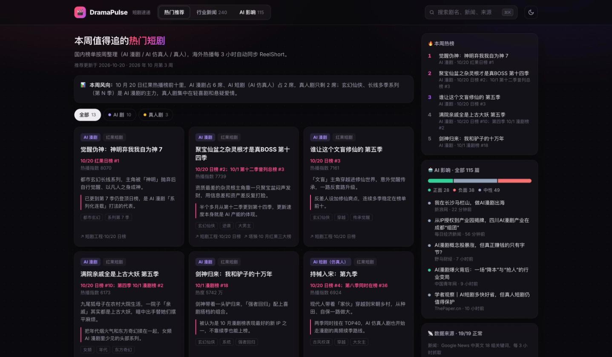
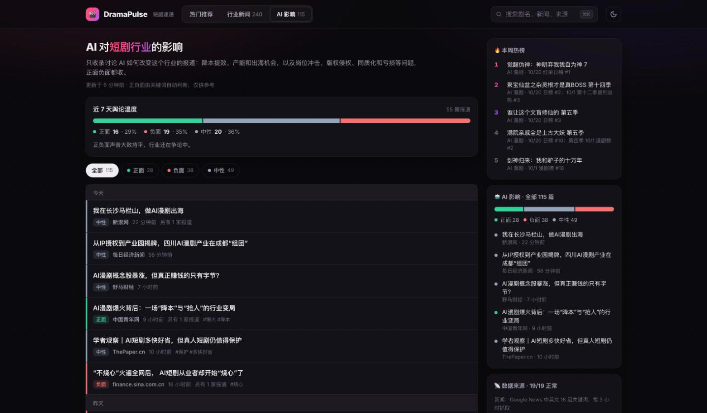

# 🎬 DramaPulse · 短剧速递

> 红果官方热播榜（热播 / 真人 / AI / 漫剧各 100 部，带评分、简介、可直接去红果看）+ 抖音短剧日榜 TOP100 / 预约榜 / 口碑榜（每天自动）+ 每周编辑推荐 + 短剧行业新闻 + AI 对短剧行业的影响（正面 / 负面都收）

**🌐 在线访问：[https://climb0516.github.io/short-drama/](https://climb0516.github.io/short-drama/)**

---

## 截图

**热门推荐**：每周整理的国内热榜（标注 AI 漫剧 / AI 仿真人 / 真人），下方是自动同步的 ReelShort 海外 TOP 和新上线



**AI 影响**：只收讨论 AI 如何改变短剧行业的报道，每条标注正面 / 负面 / 中性，顶部是近 7 天的舆论温度



---

## 三个栏目

| 栏目 | 内容 | 更新方式 |
|------|------|------|
| 热门推荐 | **红果官方榜**：红果短剧官网的红果热播榜、真人剧 / AI 剧 / 漫剧热播榜各 100 部，热度、评分、收藏、点赞、题材、剧情简介，详情底部「▶ 在红果看」直达官网播放页。**抖音榜**：抖音短剧热播榜 TOP100（体裁 AI 短剧 / 漫剧 / 真人剧、题材、标签、热播指数、排名升降、在榜天数）、排名飙升、今日新上榜、预约榜 TOP30、口碑宝藏、题材热度；点开有排名走势和数据解读。**编辑推荐**：每周整理的几部，带剧情和「为什么火」。**海外**：ReelShort TOP / 新上线 | 国内榜单：爬虫每次运行抓短剧工程风向标页；编辑推荐：`/go-drama-picks` Skill 每周整理 → `picks.json`；海外：爬虫自动 |
| 行业新闻 | 政策监管、平台、出海、数据报告、资本，中英文媒体，同一事件多家报道会合并 | 爬虫自动，每 3 小时 |
| AI 影响 | AI 给行业带来的正面影响（降本提效、产能、出海翻译、新机会）和负面影响（岗位冲击、换脸侵权、同质化、亏损泡沫），附舆论温度条 | 爬虫自动，每 3 小时 |

### 「AI 影响」怎么筛、怎么判正负

1. 标题必须提到短剧（短剧 / 微短剧 / 漫剧 / microdrama / ReelShort…）
2. 同时命中 **AI 类词**（AI、AIGC、大模型、换脸、Sora、可灵…）和 **影响类词**（冲击、取代、成本、版权、演员、编剧、泡沫、机遇…）才归入本栏；只提到 AI、没谈影响的新闻（比如某部 AI 剧上线）归入「行业新闻」，并打上 AI 标记
3. 用正面词表、负面词表统计命中数，哪边多就判哪边，持平则标中性。词表在 `scraper.py` 的 `POS_KW` / `NEG_KW`

关键词判断难免有误判，尤其是「能否取代…？」这种疑问句标题。误判多了可以改用 Claude API 分类。

---

## 技术架构

```
GitHub Actions（每 3 小时第 17 分 / 手动 dispatch / 修改 scraper.py 或 workflow 后 push）
  ↓ python scraper.py（只用标准库）
  ↓ 线程池并发（8 线程）：Google News RSS 18 条中英文查询 + ReelShort 首页
  ↓ 串行：短剧工程「短剧风向标」抖音榜（热播 TOP100 / 预约 / 口碑，前 50 部抓单剧页）
  ↓ 串行：红果短剧官网 /rank 四个热播榜（每榜 5 页 × 20 部）+ 抖音榜里不在红果榜的剧补抓红果详情页
  ↓ 新闻：classify() 分栏 + 正负面判断 → 与历史合并（保留 45 天）→ URL 去重 → dedupe() 标题相似合并
  ↓ 封面下载到 covers/c/ → 写入 data.json → commit data.json + covers/c
       ↓
Claude Code /go-drama-picks Skill（每周手动）
  ↓ WebFetch 短剧工程日榜 + WebSearch 红果 / DataEye / AI 短剧榜
  ↓ 筛选归类 → 封面下载到 covers/ → 覆盖写 picks.json → 用户确认后 push
       ↓
GitHub Pages（index.html 读取同目录 data.json + picks.json，每 10 分钟重读）
  ↓ 三个页签：热门推荐 / 行业新闻 / AI 影响
  ↓ kit 详情抽屉（#/item/pick|hg|dj|reel|news/…）+ 列表页（#/list/hg、hot、upcoming、praise、industry、ai）
```

---

## 数据来源

| 来源 | 方式 | 每次条数 | 备注 |
|------|------|---------|------|
| 红果短剧官网 热播榜 | 网页解析：`hongguoduanju.com/rank/<榜>?page=N`（服务端渲染，robots.txt 允许 /rank、/detail） | 4 榜 × 100 部（`HG_PAGES = 5`，每页 20 部；去重后约 300 部） | 榜单：全部 `hot-drama` / 真人 `hot-real-drama` / AI `hot-ai-drama` / 漫剧 `hot-comic-drama`；热度、评分、收藏、点赞、题材、简介、封面 |
| 红果详情页 | 网页解析：`/detail?series_id=<id>` | 最多 40 部（`HG_EXTRA = 40`） | 只补抓抖音榜（热播前 60 + 口碑榜）里不在红果榜的剧；缓存 7 天 |
| 短剧工程「短剧风向标」 | 网页解析：`duanjugongcheng.com/cn/fengxiangbiao`（Next.js RSC 分片里的结构化数据） | 热播榜 TOP100、口碑宝藏约 20、预约榜约 30（实测） | 整理自抖音官方短剧日榜；体裁、题材、标签、热播指数、排名升降、在榜天数、题材分布 |
| 短剧工程单剧页 | 网页解析：`/cn/bangdan/ju/<slug>` | 热播榜前 50 部（`DETAIL_TOP = 50`） | 平均排名、首登日、数据解读；同一天只抓一次 |
| Google News | RSS 搜索：`news.google.com/rss/search` | 18 条查询，每条最多约 100 条（RSS 返回上限，实测 100） | 中文 `hl=zh-CN` / 英文 `hl=en-US`；行业 9 条 + AI 影响 9 条，带 `when:14d` / `when:30d` 时间窗 |
| ReelShort | 网页解析：首页 `__NEXT_DATA__` | TOP 和 New Release 两个书架各最多 12 部（实测共 20） | 海外热播，封面、集数、播放、点赞、标签 |
| 编辑推荐 | `/go-drama-picks` Skill → `picks.json` | 10–16 部 | 每周手动，见「Skill 流程」 |

**增删来源 / 搜索词**：
- 新闻搜索词：`scraper.py` 的 `QUERIES` 列表，每项 `(查询串, ZH 或 EN)`，查询串可带 Google 的 `when:Nd`、`OR`
- 红果榜单：`HG_BOARDS`（`(key, URL 路径)`），页数 `HG_PAGES`，补抓上限 `HG_EXTRA`
- 抖音榜：`douyin_charts()`，单剧页数量 `DETAIL_TOP`，走势 / 封面保留天数 `CHART_DAYS`
- ReelShort：`reelshort(limit=12)`
- 新增一类来源：写抓取函数，在 `main()` 里调用并往 `status` 追加一条 `{name, ok, count}`

---

## 数据处理规则

**新闻分栏 `classify(item)`**（只看标题，`has()` 对 ≤4 个字母的英文短词按词边界匹配，避免 "ai" 命中 "said"）：

1. 标题必须命中 `DRAMA_KW`（短剧、微短剧、漫剧、竖屏剧、红果、ReelShort、DramaBox、microdrama、vertical drama…），否则丢弃
2. 英文条目额外过滤：来源在 `JUNK_SOURCES_EN`（白鲸出海英文站）、标题命中 `JUNK_RE`（review / plot / cast / recap / ending explained / where to watch / episode N…，SEO 内容农场）、或没有任何 `EN_NEWS_KW`（industry、market、app、revenue、billion、funding…）+ `AI_KW` 的，丢弃
3. 同时命中 `AI_KW`（ai、aigc、大模型、数字人、sora、可灵、即梦、换脸、deepfake…）和 `IMPACT_KW`（冲击、取代、失业、编剧、降本、版权、泡沫、机遇、出海、翻译…）→ 归 `ai` 栏
   - 正负面：分别数 `POS_KW`（降本、提效、产能、机遇、红利、爆款、蓝海…）和 `NEG_KW`（冲击、取代、失业、侵权、泡沫、亏损、同质化、裁员、slop…）的命中数，多的一边胜，持平为 `neutral`；命中词前 4 个存进 `signals`
4. 否则归 `industry` 栏，按 `TOPICS` 顺序打话题：`policy`（监管、广电、备案、整治）→ `overseas`（出海、ReelShort、TikTok、美国）→ `data`（财报、营收、日活、报告、播放量）→ `capital`（融资、收购、IPO）→ `platform`（红果、抖音、快手、爱奇艺）→ 兜底 `general`；只提 AI 没谈影响的标 `ai_related: true`

**合并与去重**（`main()`）：
- 本次抓取 + 上一份 `data.json` 的 `industry` / `ai` 合并，丢掉早于 `KEEP_DAYS = 45` 天的
- 历史条目也用最新词表重新 `classify()`（词表改了会重新分栏）
- 按 URL 去重 → `dedupe()`：标题去标点后取字符二元组，`similar()` 重合度 `交集 / 较小集合 > 0.72` 视为同一事件，保留最新一条，其它来源记进 `also`（前端显示「另有 N 家报道」）
- 每栏最多 `MAX_PER_SECTION = 240` 条

**抖音榜**（`douyin_charts()`）：
- `dj_objects()` 把 `self.__next_f.push` 分片拼起来，取所有以 `{"generated_at"` 开头的 JSON 块；热播榜解析不足 50 部抛错（沿用旧数据）
- 预约榜按 `subscribe_count` 重新排序编号；口碑宝藏取 `praise_no_heat`（好评高、热度未起）
- 排名走势 `history`：`slug → {日期: 名次}`，只保留近 `CHART_DAYS = 30` 天
- 单剧页缓存 `detail` 按 `_d` 日期一天只抓一次，只保留仍在榜上的

**红果榜**（`hongguo()`）：
- `hg_num()` 把「43.1万」「7318万热度」换成整数；同一剧在多个榜的名次合并到 `ranks`
- 热播榜（`all`）不足 50 部抛错；名次走势同样只留 30 天
- 抖音榜的剧号就是红果剧集 id，所以能把两边数据按 id 合并（前端详情里同时显示红果数据和抖音日榜数据）

**封面**（`dj_cover()`）：源图是约两个月后过期的签名链接，下载到 `covers/c/<id>.jpg`（带 Referer，小于 2000 字节视为失败）；不在任何榜上且文件超过 30 天的自动删除

**容错**：任一来源失败时沿用上一份 `data.json` 对应字段，`status` 里标 `ok: false, stale: true`

---

## 数据结构

不用数据库，全部存成仓库里的 JSON 文件。

**data.json** 顶层：

```
{
  "updated_at": "2026-10-22T14:10:00+08:00",   北京时间，每次运行都变
  "industry":   [新闻, …],                      最多 240 条
  "ai":         [新闻, …],                      最多 240 条
  "douyin":     { date, hot, praise, upcoming, detail, history, stats },
  "hongguo":    { updated, date, boards, items, extra, history },
  "overseas":   [ReelShort 条目, …],
  "status":     [{ "name": "短剧 when:14d", "ok": true, "count": 100 }, …]
}
```

单条新闻：

```
{
  "title": "…", "url": "Google News 跳转链接", "source": "新浪网", "source_url": "https://…",
  "time": "2026-10-22T08:26:00+00:00", "lang": "zh | en",
  "section": "industry | ai",
  "topic": "policy | overseas | data | capital | platform | general",   industry 栏
  "ai_related": false,                                                   industry 栏
  "sentiment": "positive | negative | neutral",                         ai 栏
  "signals": ["爆款"],                                                   ai 栏
  "also": ["搜狐", "21财经"]                                             同一事件的其它来源
}
```

抖音榜单条（`douyin.hot[]`；`praise[]` 多 `score`，`upcoming[]` 多 `reserve` / `awaiting`）：

```
{
  "name": "剧名", "slug": "…", "id": "红果剧集 id 或 md5 前 16 位",
  "form": "AI短剧 | 漫剧 | 真人剧", "subject": "古风权谋", "tags": ["朝堂", "神医"],
  "online": "2026-10-19", "cover": "covers/c/<id>.jpg",
  "rank": 1, "heat": 7318, "change": 0, "new": false, "top10": 2, "best": 1, "trend": "爆发型", "growth": -0.09
}
```

- `douyin.detail`：`slug → { analysis, avg, first, _d }`；`douyin.history`：`slug → { 日期: 名次 }`
- `douyin.stats`：`new` / `median` / `median_change` / `top_form` / `top_form_share` / `hot_pair` / `reserve_total` / `forms[]` / `pairs[]`

红果榜（`hongguo`）：

```
{
  "updated": "10月22日",                          红果页面上的「X月X日已更新」
  "date": "2026-10-22",
  "boards": { "all": [id…], "real": [id…], "ai": [id…], "comic": [id…] },
  "items": { "<id>": { id, name, heat, new, score, fav, like, tags, desc, ranks: { all: 1, ai: 1 }, cover } },
  "extra": { "<id>": { name, heat, score, like, fav, tags, desc, _d } },    补抓的红果详情
  "history": { "<id>": { "2026-10-22": 1 } }
}
```

ReelShort（`overseas[]`）：`title / cover / synopsis / episodes / views / likes / tags / url / shelf(top|new)`

**picks.json**（Skill 维护）：

```
{
  "updated_at": "2026-10-20", "period": "2026 年 10 月第 3 周", "summary": "本周风向",
  "items": [{ "title", "kind": "ai | live", "form", "platform", "cover", "genre": [], "heat",
              "rank_note", "synopsis", "why_hot", "sources": [{ "name", "url" }] }],
  "notes": "数据口径说明"
}
```

**历史 / 快照**：新闻靠每次与上一份 `data.json` 合并累积（45 天）；榜单名次走势存在 `douyin.history` / `hongguo.history`（30 天）；git 历史里每次提交就是一份完整快照。

---

## 前端

**kit 详情抽屉 / 列表页**：点任意条目，电脑上从右侧滑出详情抽屉，手机上从底部升起；地址同步成 `#/item/<类型>/<id>`，列表页是 `#/list/<key>`。地址可以直接分享，打开分享链接会直接弹出详情；条目已下榜 / 过期时弹出「这条内容已不在当前数据里」的提示。

列表页是新开的一层：从右侧滑入盖在首页上，返回时滑走；首页一直在底下不动，滚动位置不变。在列表里点开的详情盖在这一层之上；直接打开列表链接时不播进场动画；安卓手机可从左边缘右滑返回（iOS 用系统自带手势）。

| 类型 | 地址 | 内容 |
|------|------|------|
| 编辑推荐 | `#/item/pick/<picks 下标>` | 概况、剧情、为什么火、来源、本周其它同类；能在红果榜找到同名剧时给「▶ 在红果看」 |
| 红果榜剧 | `#/item/hg/<红果剧集 id>` | 红果数据（各榜名次、热度、评分、收藏、点赞）、简介、抖音日榜数据、红果名次走势、同类在榜 |
| 抖音榜剧 | `#/item/dj/<slug>` | 今日排名、较昨日、在榜天数、连续前十、平均排名、首次上榜、排名走势、数据解读、同题材在榜；剧号是红果 id 时合并红果数据 |
| ReelShort | `#/item/reel/<book_id>` | 集数、播放、点赞、英文简介、同榜热播 |
| 新闻 | `#/item/news/<url 哈希>` | 话题 / 情绪、信号词、同时报道的媒体、同话题或同情绪的其它报道 |

| 列表 key | 地址参数 |
|----------|----------|
| `hg` 红果官方热播榜 | `b`：all / real / ai / comic；`sort`：rank / heat / score / fav / like；`tag`：题材 |
| `hot` 抖音短剧热播榜 | `form`：AI短剧 / 漫剧 / 真人剧；`subject`：题材；`tag`：标签；`new=1`：今日新上榜；`sort`：rank / rise / days / heat |
| `upcoming` 预约榜 | — |
| `praise` 口碑宝藏 | — |
| `industry` 行业新闻 | `topic`：policy / overseas / data / capital / platform / general；`sort`：new / hot |
| `ai` AI 影响 | `senti`：positive / negative / neutral；`sort`：new / hot |

**本项目特有**：
- 三个页签（热门推荐 / 行业新闻 / AI 影响），页签、AI / 真人筛选、主题存 `localStorage`（前缀 `dp:`）
- 热门推荐页：红果官方热播榜四个榜切换（TOP10 海报墙）、抖音榜榜首横幅与 TOP10 金银铜名次、排名飙升 / 新上榜 / 预约 / 口碑横滑卡片、题材热度
- 「▶ 在红果看」直达 `hongguoduanju.com/player/<id>`
- 排名走势小图 `rankSpark()`
- AI 影响页顶部近 7 天舆论温度条
- `⌘K` 搜索，每 10 分钟自动重读 `data.json` / `picks.json`（`cache: 'no-cache'`）

---

## 本地运行

```
python3 scraper.py                     # 抓取一次，更新 data.json 和 covers/c/
python3 -m http.server 8799            # 浏览器打开 http://localhost:8799
```

- 依赖：只用 Python 标准库（workflow 用 Python 3.12），无需 `pip install`
- 环境变量：无
- 直接双击 `index.html`（file://）读不到 JSON，必须通过 HTTP 服务打开

---

## Skill 流程

`/go-drama-picks`（`~/.claude/skills/go-drama-picks/SKILL.md`）每周更新「热门推荐」里的编辑推荐（`picks.json`）。海外 ReelShort 和红果 / 抖音榜由爬虫自动抓，不在 Skill 范围。

| 步骤 | 做什么 | 技术 / 规则 |
|------|--------|-------------|
| 1. 并发检索 | ① WebFetch `duanjugongcheng.com/cn/bangdan` 拿最新日榜日期，再抓 `/cn/bangdan/<日期>` 的 TOP40（剧名、题材、热播指数、是否新上榜，TOP10 标漫剧 / AI短剧 / 真人剧）；② WebSearch「红果短剧 三大榜单 总榜 漫剧榜 AI短剧榜 <年月>」；③「真人短剧 热播榜 <月> 红果」；④「DataEye 短剧热力榜 <年月>」；⑤「AI短剧 爆款 <年月>」；⑥ 命令后带关键词时加一条定向搜索 | WebFetch + WebSearch，全部并发 |
| 2. 筛选 | 只用近 14 天榜单，日期不明或年份不对的丢弃；AI / 真人归类必须有来源依据；简介不得编造；10–16 部，真人至少 3 部；同一系列只留最新一季 | Claude 判断 |
| 3. 写 picks.json | 先读现有文件再整体覆盖；排序 AI 剧按热度在前、真人剧在后 | 结构见「数据结构」 |
| 4. 封面 | curl 下载最近 3–4 天日榜页到 scratchpad → 提取 `封面">`（HTML 反转义）→ 剧名去空格标点后完全一致优先匹配 → 存 `covers/<novel-pic/ 后哈希前 16 位>.jpg`；匹配不到就省略 `cover`；删除不再被引用的旧图 | Bash curl |
| 5. 校验 | `python3 -c "import json;json.load(open('picks.json'))"` | |
| 6. 预览 | `python3 -m http.server 8799 --bind 127.0.0.1`，列出本次剧目和与上一版的增删 | |
| 7. 推送 | **用户确认后**：`git pull --rebase` → `git add -A picks.json covers/` → `git commit -m "data: 更新热门推荐 YYYY-MM-DD"` → `git push` | GitHub Pages 自动生效（不触发爬虫，workflow 的 push 只监听 scraper.py 和 workflow 文件） |

---

## 自动更新机制

| 触发方式 | 时机 |
|---------|------|
| GitHub Actions 定时任务 | `cron: '17 */3 * * *'` = UTC 每 3 小时第 17 分 = **北京时间 02:17 / 05:17 / 08:17 / 11:17 / 14:17 / 17:17 / 20:17 / 23:17**（高峰期可能延迟） |
| 修改爬虫后 push | push 到 main 且改动了 `scraper.py` 或 `.github/workflows/scrape.yml` 时，约 1-2 分钟后触发 |
| GitHub Actions 手动 dispatch | 按需触发（Actions → Drama News Scraper → Run workflow） |
| `/go-drama-picks` Skill | 每周手动执行，push `picks.json` 后 GitHub Pages 生效 |
| 页面自动刷新 | 已打开的页面每 10 分钟重读 `data.json` 和 `picks.json` |

- **心跳**：没有单独的 `last_*.txt`；`data.json` 的 `updated_at` 每次运行都变，所以每次都会产生 `data: update drama news …` 提交，仓库保持活跃
- **60 天停用**：仓库 60 天没有提交时 GitHub 会自动停用定时任务（需在 Actions 页面重新启用）；正常每 3 小时一次提交不会触发停用，但一旦被停用就不再有新提交，需要手动启用
- 提交前 `git pull --rebase`，避免和 Skill 的 push 冲突；`concurrency: scrape` 不取消正在运行的任务

---

## 文件

| 文件 | 说明 |
|------|------|
| `index.html` | 单页前端（含内联 kit 组件），深色 / 浅色主题，手机适配，⌘K 搜索 |
| `scraper.py` | 红果榜 + 抖音榜 + 新闻 + ReelShort 抓取、分类、去重 |
| `covers/c/` | 红果 / 抖音榜单封面（爬虫维护，不在榜超过 30 天自动删除） |
| `covers/*.jpg` | 编辑推荐封面（Skill 维护） |
| `data.json` | 爬虫输出（自动提交） |
| `picks.json` | 编辑推荐（Skill 维护） |
| `.github/workflows/scrape.yml` | 定时任务 |
