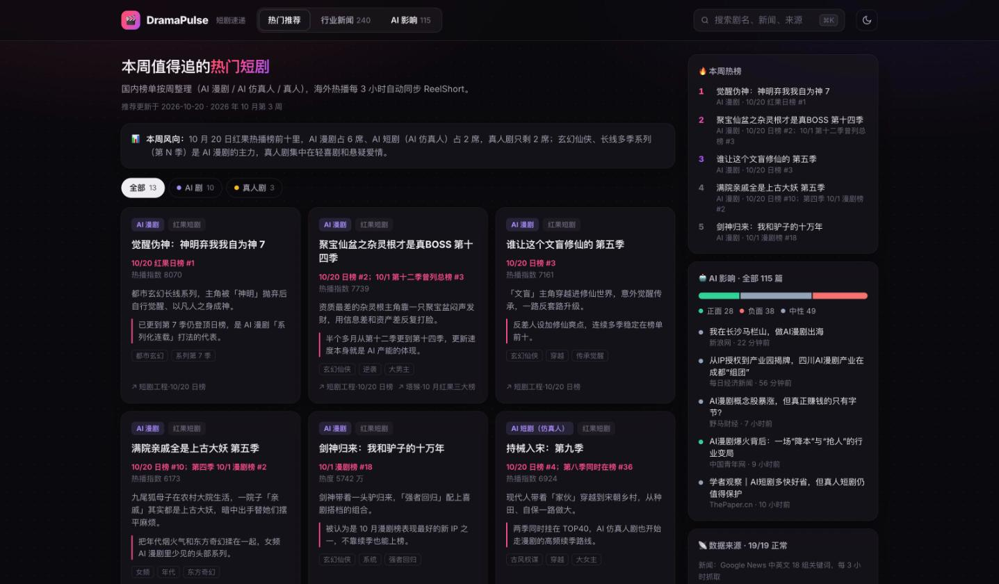
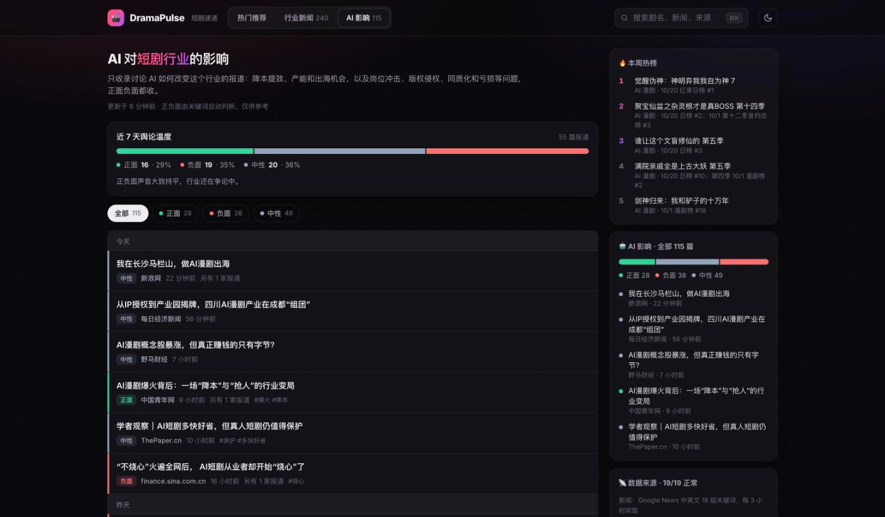

# 🎬 DramaPulse · 短剧速递

> 抖音短剧日榜 TOP100 / 预约榜 / 口碑榜（每天自动）+ 每周编辑推荐 + 短剧行业新闻 + AI 对短剧行业的影响（正面 / 负面都收）

**🌐 在线访问：[https://climb0516.github.io/short-drama/](https://climb0516.github.io/short-drama/)**

---

## 截图

**热门推荐**：每周整理的国内热榜（标注 AI 漫剧 / AI 仿真人 / 真人），下方是自动同步的 ReelShort 海外 TOP 和新上线



**AI 影响**：只收讨论 AI 如何改变短剧行业的报道，每条标注正面 / 负面 / 中性，顶部是近 7 天的舆论温度



---

## 三个栏目

| 栏目 | 内容 | 更新方式 |
|------|------|------|
| 热门推荐 | **国内榜单**：抖音短剧热播榜 TOP100（体裁 AI 短剧 / 漫剧 / 真人剧、题材、标签、热播指数、排名升降、在榜天数）、排名飙升、今日新上榜、预约榜 TOP30、口碑宝藏、题材热度；点开有排名走势和数据解读。**编辑推荐**：每周整理的几部，带剧情和「为什么火」。**海外**：ReelShort TOP / 新上线 | 国内榜单：爬虫每次运行抓短剧工程风向标页；编辑推荐：`/go-drama-picks` Skill 每周整理 → `picks.json`；海外：爬虫自动 |
| 行业新闻 | 政策监管、平台、出海、数据报告、资本，中英文媒体，同一事件多家报道会合并 | 爬虫自动，每 3 小时 |
| AI 影响 | AI 给行业带来的正面影响（降本提效、产能、出海翻译、新机会）和负面影响（岗位冲击、换脸侵权、同质化、亏损泡沫），附舆论温度条 | 爬虫自动，每 3 小时 |

### 「AI 影响」怎么筛、怎么判正负

1. 标题必须提到短剧（短剧 / 微短剧 / 漫剧 / microdrama / ReelShort…）
2. 同时命中 **AI 类词**（AI、AIGC、大模型、换脸、Sora、可灵…）和 **影响类词**（冲击、取代、成本、版权、演员、编剧、泡沫、机遇…）才归入本栏；只提到 AI、没谈影响的新闻（比如某部 AI 剧上线）归入「行业新闻」，并打上 AI 标记
3. 用正面词表、负面词表统计命中数，哪边多就判哪边，持平则标中性。词表在 `scraper.py` 的 `POS_KW` / `NEG_KW`

关键词判断难免有误判，尤其是「能否取代…？」这种疑问句标题。误判多了可以改用 Claude API 分类。

---

## 技术架构

```
GitHub Actions（每 3 小时 / 手动 / 修改爬虫后 push）
  ↓ python scraper.py（只用标准库）
  ↓ 短剧工程「短剧风向标」（抖音官方短剧日榜）：热播 TOP100 / 预约 / 口碑，前 50 部抓单剧页；封面下载到 covers/c/
  ↓ Google News RSS 中英文关键词 + ReelShort 首页
  ↓ 过滤 → 分栏 → 正负面判断 → 与历史合并去重（保留 45 天）
  ↓ 写入 data.json（douyin 字段：榜单 + 30 天排名走势）和 covers/c/ 并 commit

Claude Code /go-drama-picks（每周手动跑）
  ↓ WebSearch 红果日榜 / DataEye / 媒体榜单
  ↓ 整理成 picks.json 并 push
       ↓
GitHub Pages（index.html 读取同目录 data.json + picks.json）
```

## 本地运行

```
python3 scraper.py
python3 -m http.server 8799
# 打开 http://localhost:8799
```

## 文件

| 文件 | 说明 |
|------|------|
| `index.html` | 单页前端，深色 / 浅色主题，手机适配，⌘K 搜索 |
| `scraper.py` | 国内榜单 + 新闻 + ReelShort 抓取、分类、去重 |
| `covers/c/` | 国内榜单封面（源图是两个月后过期的签名链接，所以下载；不在榜超过 30 天自动删除） |
| `data.json` | 爬虫输出（自动提交） |
| `picks.json` | 国内热门推荐（Skill 维护） |
| `.github/workflows/scrape.yml` | 定时任务 |
